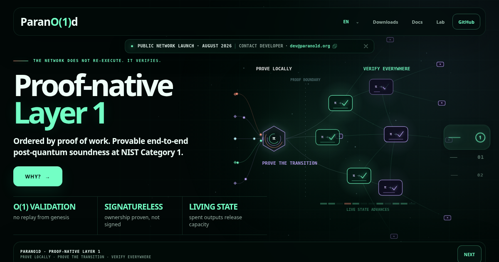

# Parano1d

Official website for [Parano1d](https://parano1d.org), a proof-native Layer 1 secured by proof of work. The site presents the v2 protocol: live value and programmable rights, Small and Large block classes, and scheduled issuance. The message center keeps the v2 activation announcement, mainnet launch and original introduction as historical messages. New major upgrade announcements use `notify: true` to show an unread badge. Historical messages and routine releases leave notifications inactive, while preserving existing read marks.



- [Documentation](https://docs.parano1d.org)
- [Parano1d Lab](https://lab.parano1d.org)

Submit a community project through the [GitHub Issues form](https://github.com/ignotusnemo/parano1d-site/issues/new?template=community-project.yml). The form collects the project link, description, maintainer, category and source code status. Maintainers review submissions and update [`ecosystem.json`](ecosystem.json). See [`CONTRIBUTING.md`](CONTRIBUTING.md) for the submission guide.

The [community directory](https://parano1d.org/?community=1) supports search, category, platform and source filters, sorting and expandable project details. Filtered views can be shared by URL. Wallet links are limited to official Parano1d products in Official links. Individual tokens and NFT collections belong in Launchpad.

## Local preview

The site has no runtime dependencies or build step.

```sh
python3 -m http.server 4171
```

Then open `http://127.0.0.1:4171`.

Validate Community builds changes with:

```sh
python3 scripts/validate_ecosystem.py
```

## Source and release links

The Source selector lists [GitHub (ignotusnemo)](https://github.com/ignotusnemo/parano1d) first, followed by the self-hosted [Forgejo repository](https://git.parano1d.org/ignotusnemo/parano1d), identified as canonical, and the [GitLab](https://gitlab.com/ignotusnemo/parano1d) and [GitHub (proof-native)](https://github.com/proof-native/parano1d) mirrors. Third-party projects retain their own repository links.

Desktop and Core downloads include direct Forgejo links to the current release as a static fallback. On the production domain, opening Downloads also checks `/release.json`, a read-only same-origin proxy to Forgejo's `/api/v1/repos/ignotusnemo/parano1d/releases/latest`. It updates the links together only when a stable release contains every expected asset at the correct Forgejo URL. An unavailable endpoint or incomplete release leaves the static links intact. No GitHub API request is made. Local preview uses the static links.

Paramo1d for Android has its own Downloads section with the APK, release notes, usage guide and hardware requirements. Its signed app releases are published in [ignotusnemo/paramo1d](https://github.com/ignotusnemo/paramo1d/releases). The app version is maintained separately from the desktop and Core release metadata.
